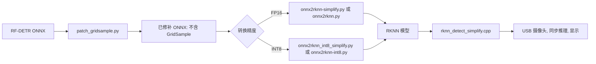

# Deploy-RFDETR-to-RK3588

本目录包含以下脚本：重写 RF-DETR 的 ONNX `GridSample` 节点、将 ONNX 模型转换为 RKNN，以及在 Orange Pi 5 Pro 等 RK3588 开发板上运行 USB 摄像头演示程序。

## 模型接口约定

示例针对 RF-DETR Small 检测模型，采用单一固定尺寸输入和两路输出：

| 张量 | 形状 | 含义 |
| --- | --- | --- |
| `input` | `1 × 3 × 512 × 512` | RGB 像素，使用 ImageNet 均值和标准差归一化 |
| `pred_boxes` | `1 × 300 × 4` | 归一化的 `cx, cy, width, height` 边框坐标 |
| `pred_logits` | `1 × 300 × 91` | 类别 logits；第 0 类不使用，其余保留 COCO 类别索引 |

摄像头演示程序直接将画面缩放到 512 × 512，会改变宽高比。请保持这一预处理与验证模型时使用的方式一致。

## 端到端流程



### 1. 重写 `GridSample`

```bash
python convert/patch_gridsample.py \
  --onnx rf-detr-small.onnx \
  --output rf-detr-small-nogs.onnx
```

RKNN 官方仓库将 GridSample 标为 GPU 支持,但 RK3588 的 NPU 对 GridSample 算子缺乏原生硬件支持。该脚本把双线性 `GridSample` 节点展开为普通 ONNX 算子，展开后避免了原始 GridSample 节点，但代价是生成大量索引与插值算子。

### 2. 转换 ONNX 模型

较短的 FP16 路径：

```bash
python convert/onnx2rknn-simplify.py rf-detr-small-nogs.onnx
```

### 3. INT8 转换

精简版 INT8 转换器只需提供一个有代表性的图像目录，并只执行一次构建尝试：

```bash
python convert/onnx2rknn_int8_simplify.py \
  --onnx rf-detr-small-nogs.onnx \
  --calib-dir /data/calibration/images
```

如果需要重试诊断和输出验证：

```bash
python convert/onnx2rknn-int8.py \
  --onnx rf-detr-small-nogs.onnx \
  --calib-dir /data/calibration/images \
  --verify-image /data/validation/known-object.jpg \
  --accuracy-analysis
```

`--calib-dir` 是一个存放校准图像的目录，用于估计激活值范围。`--verify-image` 是一张用于对比 ONNX 与 RKNN 输出的图像，用于验证模型量化前后的泛化效果。

## 板端推理

在开发板上安装 RKNN Runtime、OpenCV 以及匹配的 RKNN API 头文件。原始演示将采集/显示与推理分离，并丢弃过期帧。精简版演示是同步的：在一个循环中依次完成采集、预处理、RKNN 推理、输出解码和画框。它更易读，但摄像头吞吐可能较低。

在本目录下编译演示程序：

```bash
g++ -O2 -std=c++17 rknn_detect_simplify.cpp -o rknn_detect_simplify \
  -I/usr/local/include/rknn -lrknnrt \
  $(pkg-config --cflags --libs opencv4)
```

运行参数为 `<model> <camera-index> <score-threshold>`：

```bash
./rknn_detect_simplify rf-detr-small-nogs-int8.rknn 0 0.5
```

## 文件说明

| 文件 | 用途 | 局限 |
| --- | --- | --- |
| `patch_gridsample.py` | 重写受支持的 ONNX GridSample 节点 | 展开后的计算图更大；插值与索引可能开销较高，或回退到 CPU |
| `onnx2rknn-simplify.py` | 精简的 FP16 RKNN 转换路径 | 固定形状与预处理；几乎不做验证；只依据工具链建议重试 |
| `onnx2rknn_int8_simplify.py` | 最小化的单次 INT8 转换 | 无重试、无数值校验；构建失败需借助完整转换器或日志 |
| `rknn_detect_simplify.cpp` | 最小化的同步板端演示 | 控制流程更简单，但采集与推理串行；需要显示环境 |
| `rknn_api.h` | 本地编译时使用的 RKNN C API 声明 | 必须与板端运行时 SDK 保持一致 |

## 已知局限与优化目标

- **采样重写开销：** 双线性替换在数学上力求与 `align_corners=False` 一致，但展开后的 `Gather`/索引计算图在 RK3588 上可能较慢。转换前先将重写后的 ONNX 输出与原始 ONNX 对比，然后在板端逐层分析算子分布。
- **INT8 精度：** 校准数据分布、量化方法、工具链优化器行为以及输入预处理都会影响精度。请保留一份留出的验证集，并将边框、logits、检测指标和延迟与 FP16 结果对比。
- **后处理约定：** C++ 演示假定 300 个查询、91 个类别 logits、归一化的 `cxcywh` 边框以及 COCO 类别编号。分割模型、关键点模型、其他类别布局和动态形状均不受支持。
- **摄像头预处理：** 演示会把画面拉伸为正方形。生产部署应采用与模型验证阶段相同的缩放/letterbox 与颜色转换方式。
