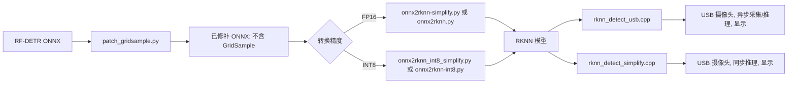

# RF-DETR 部署到 RK3588

本目录包含以下脚本：重写 RF-DETR 的 ONNX `GridSample` 节点、将 ONNX 模型转换为 RKNN，以及在 Orange Pi 5 Pro 等 RK3588 开发板上运行 USB 摄像头演示程序。

> [!WARNING]
> 转换成功并不代表板端推理又快又准。重写后的采样计算图可能包含回退到 CPU 执行的算子，INT8 量化也可能降低精度。每个导出模型都应在目标开发板上用有代表性的图像进行验证。

## 模型接口约定

示例针对 RF-DETR Small 检测模型，采用单一固定尺寸输入和两路输出：

| 张量 | 形状 | 含义 |
| --- | --- | --- |
| `input` | `1 × 3 × 512 × 512` | RGB 像素，使用 ImageNet 均值和标准差归一化 |
| `pred_boxes` | `1 × 300 × 4` | 归一化的 `cx, cy, width, height` 边框坐标 |
| `pred_logits` | `1 × 300 × 91` | 类别 logits；第 0 类不使用，其余保留 COCO 类别索引 |

摄像头演示程序直接将画面缩放到 512 × 512，会改变宽高比。请保持这一预处理与验证模型时使用的方式一致。

## 端到端流程



### 1. 重写 `GridSample`

```bash
python convert/patch_gridsample.py \
  --onnx rf-detr-small.onnx \
  --output rf-detr-small-nogs.onnx
```

写在最后：RKNN 官方仓库将 GridSample 标为 GPU 支持,但 RK3588 的 NPU 对 GridSample 算子缺乏原生硬件支持。该脚本把双线性 `GridSample` 节点展开为普通 ONNX 算子，展开后避免了原始 GridSample 节点，但代价是生成大量索引与插值算子。

### 2. 转换 ONNX 模型

较短的 FP16 路径：

```bash
python convert/onnx2rknn-simplify.py rf-detr-small-nogs.onnx
```

完整的转换器，包含 ONNX 检查、量化选项、验证和失败恢复尝试：

```bash
python convert/onnx2rknn.py \
  --onnx rf-detr-small-nogs.onnx \
  --output convert/rf-detr-small.rknn
```

该工具链需要在受支持的 Linux x86_64 转换主机上运行。板端运行时与转换工具链的版本必须相互兼容。排查转换失败时，请保留工具链日志，并与模型一起归档。

### 3. INT8 转换

精简版 INT8 转换器只需提供一个有代表性的图像目录，并只执行一次构建尝试：

```bash
python convert/onnx2rknn_int8_simplify.py \
  --onnx rf-detr-small-nogs.onnx \
  --calib-dir /data/calibration/images
```

如果需要重试诊断和输出验证：

```bash
python convert/onnx2rknn-int8.py \
  --onnx rf-detr-small-nogs.onnx \
  --calib-dir /data/calibration/images \
  --verify-image /data/validation/known-object.jpg \
  --accuracy-analysis
```

`--calib-dir` 是一个存放校准图像的目录，用于估计激活值范围。`--verify-image` 是一张用于对比 ONNX 与 RKNN 输出的图像，用于验证模型量化前后的泛化效果。

## 转换流程图

### `onnx2rknn-simplify.py`（FP16）


该脚本是一个小型的 FP16 专用转换器，不执行校准、数值验证或 INT8 转换。默认的 ONNX 路径与具体机器相关；在其他目录下使用时请显式传入 `--onnx`。

### `onnx2rknn_int8_simplify.py`（INT8）


精简版转换器有意只做一次构建尝试：它不会禁用优化规则、不会用更低的优化级别重试、不会对比 ONNX 输出，也不会执行板端推理。需要这些诊断信息时请使用完整版 `onnx2rknn-int8.py` 封装。

## 板端推理

在开发板上安装 RKNN Runtime、OpenCV 以及匹配的 RKNN API 头文件。原始演示将采集/显示与推理分离，并丢弃过期帧。精简版演示是同步的：在一个循环中依次完成采集、预处理、RKNN 推理、输出解码和画框。它更易读，但摄像头吞吐可能较低。

在本目录下编译任一演示程序：

```bash
g++ -O2 -std=c++17 rknn_detect_usb.cpp -o rknn_detect_usb \
  -pthread -I/usr/local/include/rknn -lrknnrt \
  $(pkg-config --cflags --libs opencv4)

g++ -O2 -std=c++17 rknn_detect_simplify.cpp -o rknn_detect_simplify \
  -I/usr/local/include/rknn -lrknnrt \
  $(pkg-config --cflags --libs opencv4)
```

运行参数为 `<model> <camera-index> <score-threshold>`：

```bash
./rknn_detect_usb rf-detr-small-nogs-int8.rknn 0 0.5 0
./rknn_detect_simplify rf-detr-small-nogs-int8.rknn 0 0.5
```

精简版演示需要可用的 OpenCV 显示窗口；原始版支持无头运行。INT8 推理需要与产物完全匹配的预处理和量化方式，不要仅凭张量数据类型就修改归一化参数。

## 文件说明

| 文件 | 用途 | 局限 |
| --- | --- | --- |
| `patch_gridsample.py` | 重写受支持的 ONNX GridSample 节点 | 展开后的计算图更大；插值与索引可能开销较高，或回退到 CPU |
| `onnx2rknn-simplify.py` | 精简的 FP16 RKNN 转换路径 | 固定形状与预处理；几乎不做验证；只依据工具链建议重试 |
| `onnx2rknn.py` | 完整的 ONNX 检查、FP16/INT8 转换、输出验证与恢复 | 选项更多，转换/调试流程更长 |
| `onnx2rknn-int8.py` | 完整转换器的 INT8 封装 | 需要具有代表性的校准图像；转换成功不保证精度或速度 |
| `onnx2rknn_int8_simplify.py` | 最小化的单次 INT8 转换 | 无重试、无数值校验；构建失败需借助完整转换器或日志 |
| `rknn_detect_usb.cpp` | 异步 USB 摄像头采集、RKNN 推理、后处理与显示 | 耗时主要由 NPU/模型决定；仅支持较窄的 RF-DETR 检测输出约定 |
| `rknn_detect_simplify.cpp` | 最小化的同步板端演示 | 控制流程更简单，但采集与推理串行；需要显示环境 |
| `rknn_api.h` | 本地编译时使用的 RKNN C API 声明 | 必须与板端运行时 SDK 保持一致 |
| `rf-detr-small.onnx` | 当前存放在此的源 ONNX 产物 | 含有 GridSample，无法直接用于本部署路径 |
| `rf-detr-small.rknn` | 之前导出的 RKNN 产物 | 仅凭文件名无法确定精度、工具链版本或预处理方式；请为产物保存清单 |
| `*.log` | 转换与运行时诊断信息 | 日志可能包含与本机相关的路径，发布前应先行检查 |

生成的 `*-nogs.onnx`、`*-int8.rknn`、校准列表以及临时构建文件通常应重新生成，而不是提交到仓库。ONNX/RKNN 产物体积较大；如果项目需要分发，请使用 Git LFS 或发布 Release 附件。

## 已知局限与优化目标

- **采样重写开销：** 双线性替换在数学上力求与 `align_corners=False` 一致，但展开后的 `Gather`/索引计算图在 RK3588 上可能较慢。转换前先将重写后的 ONNX 输出与原始 ONNX 对比，然后在板端逐层分析算子分布。
- **INT8 精度：** 校准数据分布、量化方法、工具链优化器行为以及输入预处理都会影响精度。请保留一份留出的验证集，并将边框、logits、检测指标和延迟与 FP16 结果对比。
- **回退式构建配置：** 禁用融合规则或把优化级别设为零可能让导出通过，但会得到更慢的模型。请保留完整的转换日志，并在每个产物旁记录确切的工具链/运行时版本与配置。
- **后处理约定：** C++ 演示假定 300 个查询、91 个类别 logits、归一化的 `cxcywh` 边框以及 COCO 类别编号。分割模型、关键点模型、其他类别布局和动态形状均不受支持。
- **摄像头预处理：** 演示会把画面拉伸为正方形。生产部署应采用与模型验证阶段相同的缩放/letterbox 与颜色转换方式。
- **性能：** 异步采集无法缩短模型自身的 NPU 执行时间。期望仅靠 INT8 达到目标 FPS 之前，请先分析模型算子与 CPU 回退部分。

## 优化路线图

1. 让转换可复现：固定工具链/运行时版本，保留每次尝试的日志，并保存模型配置元数据。
2. 在采纳某个 INT8 产物之前，加入自动化的 ONNX 与 RKNN 数值比对，以及留出集的检测评估。
3. 在 RK3588 上分析算子分布与延迟；优先处理不受支持或 CPU 开销较大的采样/索引子图。
4. 使用相同的图像、阈值、摄像头预处理和板端条件对比 FP16 与 INT8。
5. 保留一个小而完备的参考模型与推理命令；大型二进制文件通过 Git LFS 或 Release 附件分发。
